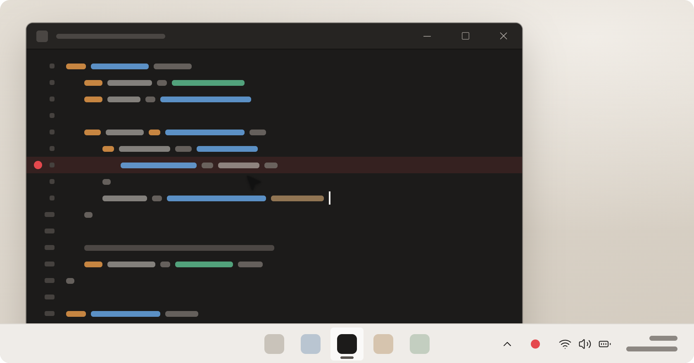

<div align="center">


# breakpoint

**Breakpoints for humans.**<br>
A Windows tray app that tells you to stand up, drink water and pause.<br>
Walk away from the desk and the nudge counts. There is nothing to click.

[](https://github.com/rawasmhd/breakpoint/releases/latest)


[](LICENSE)

### [Download breakpoint.exe](https://github.com/rawasmhd/breakpoint/releases/latest/download/breakpoint.exe)

No installer. No account. No telemetry.

<br>



</div>

<br>

## The idea

In a code editor, a breakpoint is a red dot in the gutter: the place where the program stops on purpose. breakpoint puts that dot in your day.

Most break reminders ask you to click "Done" for a break you already took, or they cover your screen until you obey. breakpoint watches for the one thing that matters: did you actually step away?

- **You walk away, it counts.** Be away for 2 minutes and a Stand/Move nudge is done. Lock the screen and it is done at once.
- **No Done button.** The popup closes by itself when the nudge counts. Snooze and Skip are there if you need them.
- **It never steals your keyboard.** The popup sits above the tray and does not take focus, so you can finish the line you are typing.
- **Silent outside work hours.** No nudges at night or on your weekend. One click turns it off until the next work day.

## How it works

| | |
| --- | --- |
| **1. A nudge falls due** | After 30 minutes of active time, a small popup appears above the tray: *Stand up and move*. The tray dot gets a ring. |
| **2. You step away** | A live countdown shows how long until it counts: *Away 1:59 more and it counts*. Touch the mouse and the countdown starts again. |
| **3. It counts** | After 2 minutes away, the popup closes and the tray dot is solid again. The next 30 minutes start when you come back. |

Time away from the computer does not count as work. If you go to a meeting for an hour, breakpoint does not greet you with three overdue nudges.

## Three nudges

| | Nudge | When (Balanced) | Counts when |
| --- | --- | --- | --- |
|  | **Stand/Move** | every 30 min of active time | you are away for 2 min, or you lock the screen |
|  | **Pause** | every 60 min of active time, and it insists | you are away for 5 min, or you lock the screen |
|  | **Water** | every 60 min, as a line on the next nudge | nothing to do: it is a heads-up |

Pick a rhythm on the first-run page, and change it in Settings at any time:

- **Gentle:** stand every 45 min, pause every 90 min.
- **Balanced:** stand every 30 min, pause every 60 min.
- **Strict:** stand and pause every 30 min, like a Pomodoro.

Every number stays editable. The default work week is Sunday to Thursday, 08:00 to 17:00.

## The tray dot

| | State | Meaning |
| --- | --- | --- |
|  | On | Nudges can fire. Nothing is waiting. |
|  | Pending | A nudge is waiting for you to step away. |
|  | Quiet | Outside work hours, on your weekend, or turned off. |

The three states differ in shape, not only in colour, so they read on any taskbar and for colour-blind users. Click the dot for its menu: today's count (*Today: 7 taken, 2 skipped*), Settings, and *Turn off until next work day*. After hours the same item reads *Turn on until midnight*, for a late night.

## Based on research

The default times come from studies on sitting, micro-breaks, eye strain, hydration and working hours. [RESEARCH.md](docs/RESEARCH.md) grades each source and says where the evidence is thin.

## Small and private

- **One file.** `breakpoint.exe` is under 450 KB. It needs no runtime and no installer.
- **Nothing leaves your machine.** No account, no cloud sync, no telemetry.
- **Plain files.** Settings live in one JSON file. A local event log records what was taken and skipped.
- **Native.** Written in Rust on raw Win32. It follows your Windows light or dark theme, and screen readers can read every control.

## Install

1. Download [`breakpoint.exe`](https://github.com/rawasmhd/breakpoint/releases/latest/download/breakpoint.exe) from the [latest release](https://github.com/rawasmhd/breakpoint/releases/latest) and put it wherever you like.
2. Run it. The exe is not code-signed, so Windows SmartScreen may say *Windows protected your PC*. Click **More info**, then **Run anyway**. Windows remembers this for that file.
3. Pick a rhythm on the first-run page. breakpoint then lives in the tray.

To check the download, compare its hash with `breakpoint.exe.sha256` from the same release:

```
Get-FileHash breakpoint.exe -Algorithm SHA256
```

### Files and uninstall

Settings live in `%APPDATA%\breakpoint\config.json` and the event log in `%APPDATA%\breakpoint\log\`. To uninstall: untick Start with Windows in Settings (or delete the `breakpoint` value under `HKCU\Software\Microsoft\Windows\CurrentVersion\Run`), quit from the tray, then delete `breakpoint.exe` and that folder.

## Project

v1 is complete. Every feature of the [v1 spec](docs/SPEC.md) works, from the first-run page to the event log.

| Document | What it covers |
| --- | --- |
| [SPEC.md](docs/SPEC.md) | What the app does, settled on the [wayfinder map](https://github.com/rawasmhd/breakpoint/issues/23) |
| [DESIGN.md](docs/DESIGN.md) | The look and the voice: colours, type, the popup and every control |
| [RESEARCH.md](docs/RESEARCH.md) | The evidence behind the default times |
| [GLOSSARY.md](GLOSSARY.md) | The exact words: nudge, Away, Skip, Pause |
| [ADR 0001](docs/adr/0001-rust-for-the-desktop-app.md) | Why Rust |

Ideas beyond v1 are in [SPEC.md, Later](docs/SPEC.md#17-later). For a bug or an idea, [open an issue](https://github.com/rawasmhd/breakpoint/issues/new).

## Build from source

You need stable Rust and the MSVC build tools (Visual Studio Build Tools, "Desktop development with C++").

```
cargo build --release
cargo test
```

The exe is `target\release\breakpoint.exe`. Rust on the MSVC toolchain, `tray-icon` for the tray, the `windows` crate for everything else (the popup, the dialogs and presence detection). Design and crates: [SPEC.md, technical design](docs/SPEC.md#12-technical-design).

The platform-free logic lives in `src/core/` and must never use the `windows` crate (CI checks this). The Win32 side lives in `src/platform/`. CI also runs `cargo fmt --check` and `cargo clippy --all-targets -- -D warnings`. The v1 build issues are the sub-issues of [issue 37](https://github.com/rawasmhd/breakpoint/issues/37).

## License

[MIT](LICENSE)
